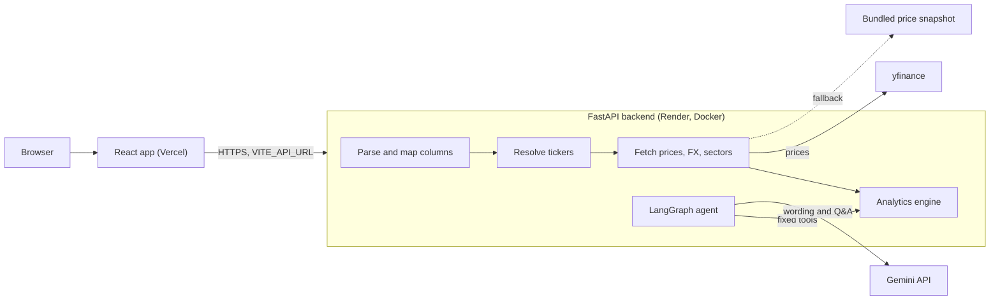

# Portfolio Risk Analyzer

Upload a broker holdings file (CSV, Excel or JSON) and get portfolio risk, sector exposure and drawdown, with AI-written insights that can only quote numbers the code computed.

> **Analytics only, not financial advice.** The app describes how a portfolio would have behaved in the past. It never recommends buying or selling.

## Live demo

| | Link |
| --- | --- |
| App (Vercel) | https://YOUR-APP.vercel.app |
| API health (Render) | https://YOUR-API.onrender.com/health |

The API runs on a free Render service that, according to Render's documentation, sleeps after 15 idle minutes and takes about a minute to wake (I have not timed this), so the first request after a pause can be slow. The app shows a "Waking up the server" banner while that happens.

## Screenshots

_Screenshots are added by hand before release (see `docs/RELEASE_CHECKLIST.md`). Planned files in `docs/screenshots/`:_

- `dashboard.png`: KPIs, risk cards and charts for the mixed sample portfolio
- `mapping.png`: the column-mapping dialog
- `chat.png`: the chat drawer with the tools it used
- `demo.gif`: pick a sample, scroll the dashboard, ask a question

## Features

- Upload CSV, Excel (.xlsx) or JSON up to 5 MB and 500 rows, or start from three sample portfolios (India, US, mixed).
- Broker layout detection by header names, with a column-mapping dialog (and an optional AI suggestion) when the layout is unknown.
- Ticker resolution for NSE (`.NS`), BSE (`.BO`) and US symbols, with a panel listing symbols that could not be resolved.
- Holdings value, P&L, weights, top-5 concentration and HHI; sector exposure.
- Risk: annualized volatility, beta against a chosen benchmark, Sharpe ratio, 1-day 95% historical VaR, maximum drawdown with a drawdown chart, and a correlation heatmap.
- INR or USD base currency with FX conversion, and a benchmark selector.
- AI insights checked against the computed numbers, and a chat that answers questions through eight fixed analytics tools and shows which tools it used.
- Works without the AI: insights fall back to template text and chat is disabled.
- Accessible and responsive: keyboard navigable, contrast-checked, no horizontal scroll at phone width.
- Structured JSON request logs, per-client and global limits on AI endpoints, and optional Langfuse tracing.

## Architecture



The browser only talks to the backend. The backend keeps no state and writes no uploads to disk. The agent reads results from the analytics engine and never computes them.

## Tech stack

| Layer | Choice |
| --- | --- |
| Frontend | React 19, Vite, strict TypeScript, Plotly (basic bundle, loaded on demand), Vitest and Testing Library |
| Backend | Python 3.11+, FastAPI, pydantic v2, pandas, numpy |
| Market data | yfinance (prices, sectors, USDINR=X), with a bundled offline snapshot |
| Agent | LangGraph, Gemini (`gemini-3.6-flash` by default), optional Langfuse |
| Validation | quantstats and numpy as references, pytest, a scripted-model eval suite |
| Delivery | Docker, GitHub Actions (CI, keep-alive), Render (backend), Vercel (frontend) |

## How it works

1. **Parser.** `app/services/parsers.py` reads the file in memory, detects the columns from header names, and either returns holdings or asks for a mapping. File contents and holding names are treated as untrusted input.
2. **Resolver.** Each symbol is tried as `.NS`, `.BO`, then the plain US symbol (an exchange column narrows the order). Symbols that match nothing are listed back to the user instead of failing silently.
3. **Prices and FX.** Daily adjusted closes come through an in-memory TTL cache, then a disk cache, then yfinance. If live data fails, the bundled snapshot is used and a warning says so. USD holdings are converted with USDINR=X.
4. **Analytics.** `app/analytics` computes every metric from a buy-and-hold model of the current quantities. The formulas and assumptions are in [`docs/METRICS.md`](docs/METRICS.md).
5. **Agent.** Three small LangGraph flows (column-mapping suggestion, insight writer, Q&A) call the model through a thin interface. The Q&A agent can only call eight fixed tools: `get_summary`, `get_top_holdings`, `get_sector_exposure`, `get_risk_metrics`, `get_drawdown_periods`, `get_correlations`, `risk_contribution` and `what_if_remove`. A validator then checks that every number in the model's text appears in the analysis or a tool output (within rounding) and that the text contains no buy or sell advice; otherwise the answer is repaired once and then replaced with a safe message. No code is executed anywhere.

## Validation

`python scripts/validate_metrics.py` rebuilds each sample portfolio's returns with plain numpy from the same cleaned prices, then compares the engine with quantstats (volatility, Sharpe, maximum drawdown) and numpy (beta, VaR). Full output: [`docs/VALIDATION.md`](docs/VALIDATION.md).

| Metric | Reference | Largest error over india, us, mixed | Tolerance |
| --- | --- | ---: | ---: |
| Volatility | quantstats | 0 (relative) | 0.5% |
| Sharpe | quantstats | 0 (relative) | 0.5% |
| Max drawdown | quantstats | 0 (relative) | 0.5% |
| Beta | numpy covariance | 0 (relative) | 0.5% |
| VaR 95 | numpy percentile | 3.47e-18 (absolute) | 1e-6 |

The comparison feeds the same return series to both sides, so it checks the formulas and conventions (for example the compounded daily risk-free rate), not the price data. The engine's unit tests also use hand-calculated fixtures.

## Tests

`cd backend && pytest -q --cov=app` runs 338 tests with 98% line coverage (100% for `app/analytics`; CI fails below 80% there). `cd frontend && npm run test` runs 78 tests covering the upload flow, the mapping dialog, error states, the dashboard with a mocked analysis, the chat drawer, the API client and the heatmap contrast. Backend tests run offline against the price snapshot and never call a real model.

## Agent evaluation

`python scripts/run_agent_eval.py` asks 27 questions (tool choice, risk, drawdown, correlation, what-if, advice requests, prompt-injection holding names) on the mixed sample portfolio, analysed from the offline snapshot. One of the 27 is a scripted answer with a made-up number, which exists only to prove that the validator blocks it, so a run against the real model has 26 questions.

| Run | Tool selection | Numeric accuracy | Numbers not in tool outputs | Advice violations | Answers blocked by validation |
| --- | ---: | ---: | ---: | ---: | ---: |
| `--fake-llm` (scripted answers, used in CI) | 100.0% | 100.0% | 0 | 0 | 2 |
| Gemini (`gemini-3.6-flash`) | not measured | not measured | not measured | not measured | not measured |

The scripted run checks the pipeline and the validators; it cannot show how good the model is. The Gemini row is empty on purpose: when I tried the real-model run on 2026-10-28, only 4 of the 26 questions got an answer before the free-tier quota rate-limited the rest (even with a 30 second pause between questions), so there is no valid score to report. To measure it yourself, run `python scripts/run_agent_eval.py --pause 30` with a `GEMINI_API_KEY` set and a fresh quota; unanswered questions are counted as errors, not as passes.

## Performance

`python scripts/measure_analysis_time.py` times `POST /api/analyze` in-process on my Windows laptop (Python 3.13), 2-year lookback. Cold means empty caches, so every price is downloaded from Yahoo Finance; warm repeats the request with caches filled. The three sample portfolios and a 20-stock mixed portfolio (10 NSE and 10 US stocks) were measured, 3 cold runs and 5 warm runs each. Details: [`docs/PERFORMANCE.md`](docs/PERFORMANCE.md).

| Portfolio | Holdings | Cold (live), seconds, median (range) | Warm, seconds, median (range) |
| --- | ---: | ---: | ---: |
| india | 13 | 6.68 (6.50 to 11.66) | 0.03 (0.02 to 0.03) |
| us | 12 | 16.67 (16.63 to 16.92) | 0.02 (0.02 to 0.02) |
| mixed | 12 | 6.79 (5.93 to 6.95) | 0.03 (0.03 to 0.03) |
| 20-stock mixed | 20 | 19.20 (18.36 to 19.22) | 0.04 (0.04 to 0.05) |

From the bundled snapshot with no network (`--offline`, [`docs/PERFORMANCE_OFFLINE.md`](docs/PERFORMANCE_OFFLINE.md)) the same requests take 0.06 to 0.10 seconds, so almost all of the cold time is waiting for Yahoo Finance. The US sample is slower than the India sample because symbols without an exchange are looked up as `.NS` and `.BO` over the network before the plain US symbol. These timings are from a laptop, not the deployed free-tier server, and do not include the browser's network time.

## Limitations

- **Historical buy-and-hold model.** Metrics describe how today's quantities would have behaved over the window, with no rebalancing. They are not what the user actually earned and they do not predict anything.
- **yfinance reliability.** Yahoo Finance is an unofficial source and can rate-limit, change symbols or return gaps. The app then uses a bundled snapshot of past prices and says so in a warning, so numbers may be out of date.
- **Free-tier cold starts.** The free Render service sleeps when idle and takes about a minute to wake, per Render's documentation. A keep-alive workflow pings it every 10 minutes, but GitHub may delay scheduled runs.
- **Gemini quotas.** The free tier has small limits. When Google rate-limits a call, chat returns a friendly error and insights fall back to template text. The app also applies its own per-client and daily limits.
- **Ticker coverage.** Only NSE, BSE and US symbols are resolved, and sector data comes from yfinance.
- **No persistence.** Uploads and results exist only in memory, by design.

## Local setup

Needs Python 3.11 or newer and Node.js 20 or newer. `make setup`, `make test`, `make lint`, `make run-backend` and `make run-frontend` wrap the commands below (the Python venv is `backend/.venv`).

```bash
# Backend
cd backend
python -m venv .venv
.venv/Scripts/pip install -r requirements-dev.txt   # Windows; use .venv/bin/pip elsewhere
cp .env.example .env            # optional: add GEMINI_API_KEY
uvicorn app.main:app --reload --port 8000           # http://localhost:8000/docs

# Frontend (second terminal)
cd frontend
cp .env.example .env            # sets VITE_API_URL, which has no default
npm install
npm run dev                     # http://localhost:5173
```

Checks: `cd backend && pytest -q --cov=app && ruff check . && ruff format --check .`, then `cd frontend && npm run lint && npm run test && npm run build`. Other scripts: `python scripts/validate_metrics.py`, `python scripts/run_agent_eval.py --fake-llm`, `python scripts/measure_analysis_time.py`. Optional git hooks: `pip install pre-commit && pre-commit install`.

Without a `GEMINI_API_KEY` the dashboard still works; insights use templates and chat reports "AI unavailable". `GEMINI_MODEL` selects another model. Optional Langfuse tracing is described in [`docs/ARCHITECTURE.md`](docs/ARCHITECTURE.md).

Docker: `make docker-build` then `make docker-run` serves the API on http://localhost:7860.

## Deployment

The full checklist, with environment variables and troubleshooting, is in [`docs/SETUP_AND_DEPLOYMENT.md`](docs/SETUP_AND_DEPLOYMENT.md).

1. **Backend on Render.** New, Blueprint, connect the GitHub repository. `render.yaml` defines a free Docker web service that deploys a commit once its GitHub checks pass. Set `GEMINI_API_KEY` and `ALLOWED_ORIGINS` in the Render dashboard.
2. **Frontend on Vercel.** Import the repository, set Root Directory to `frontend`, and add `VITE_API_URL` with the Render service URL.
3. **Close the loop.** Add the Vercel URL to `ALLOWED_ORIGINS` on Render, and set the GitHub repository variable `BACKEND_URL` so the keep-alive workflow can ping `/health`.

## Project structure

```text
backend/
  app/
    main.py  config.py  schemas.py  errors.py  observability.py  ratelimit.py
    routers/     health, parse, analyze, chat
    services/    parsers, tickers, prices, fx, sectors, cache, pipeline, samples
    analytics/   returns, risk, drawdown, concentration, correlation, engine
    agent/       graph, tools, prompts, llm, validation, templates, models, tracing
  data/          sample portfolios, price snapshot, sector map
  tests/         unit, agent, evals, API tests
  Dockerfile  requirements.txt  requirements-dev.txt
frontend/        React app (src/api, hooks, lib, components) and its tests
scripts/         validate_metrics.py  run_agent_eval.py  measure_analysis_time.py  snapshot_prices.py
docs/            PRD, ARCHITECTURE, METRICS, VALIDATION, PERFORMANCE, SETUP_AND_DEPLOYMENT, RESUME, RELEASE_CHECKLIST
.github/workflows/   ci.yml  keepalive.yml
render.yaml  Makefile  .pre-commit-config.yaml
```

## License

[MIT](LICENSE)
