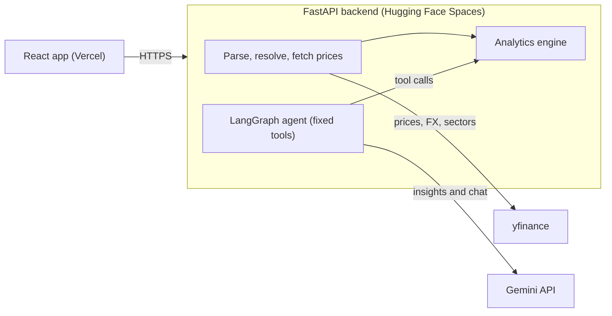

# Architecture and API

One repository, two deployables: a React app on Vercel calls a FastAPI service on Hugging Face Spaces. The analytics engine is plain Python; the LLM only helps with column mapping, insight wording and Q&A through fixed tools.



The browser talks only to the backend; the agent reads results from the analytics engine and never computes them.

## Tech stack

| Layer | Choice | Why |
| --- | --- | --- |
| Frontend | React, Vite, TypeScript, Plotly | Fast to build, strong chart support |
| Backend | Python 3.11+, FastAPI, pydantic v2, pandas, numpy | Typed API, standard for finance maths |
| Market data | yfinance (prices, sectors, USDINR=X) | Free, covers NSE, BSE and US |
| Agent | LangGraph with Gemini free tier | Graph of small, testable steps |
| Validation | quantstats, pytest | Independent reference for metrics |
| MLOps | Docker, GitHub Actions, optional Langfuse | CI/CD, tracing, repeatable deploys |
| Hosting | Hugging Face Spaces (Docker), Vercel | Both free tiers |

## API endpoints

| Method | Path | Request | Response |
| --- | --- | --- | --- |
| GET | /health | none | status, version, git sha, ai_available |
| GET | /api/samples | none | list of sample portfolios |
| POST | /api/parse | file (CSV, Excel, JSON) | detected broker, holdings, warnings, unresolved symbols, or a request for column mapping |
| POST | /api/analyze | holdings, base currency, benchmark, lookback years | full analysis result |
| POST | /api/insights | analysis result | list of validated insights |
| POST | /api/chat | analysis result, message history, optional original analyze request | answer and the tool calls used |
| POST | /api/mapping/suggest | column headers, up to 3 sample rows | suggested column mapping for the user to confirm |

### API behaviour

- **Errors:** every error is JSON `{"error": "<slug>", "detail": "<message>"}`. Slugs include `validation_error` (422), `unsupported_media_type` (415), `payload_too_large` (413), `bad_request` (400), `not_implemented` (501). Responses carry an `X-Request-ID` header (a valid incoming one is echoed).
- **POST /api/parse** takes a multipart `file` (and optional `mapping`, a JSON object of canonical field to column name, used after a mapping request). Returns `status` (`ok` or `needs_mapping`), `broker` (a hint from header names, or null), `holdings`, `columns`, `detected`, `missing`, `warnings` and `unresolved_symbols`. Only .csv, .xlsx and .json are accepted; .xlsm and .xls get a message to save as .xlsx. Files over `MAX_UPLOAD_MB` give 413, more than `MAX_ROWS` rows give 413, and a missing `Content-Length` gives 411. Uploads are read in memory only.
- **POST /api/analyze** takes `holdings`, `base_currency` (INR or USD), optional `benchmark` and `lookback_years` (1 to 5, default 2). With no benchmark, ^NSEI is used when most value is Indian, otherwise ^GSPC. Unresolved symbols are excluded and listed in `warnings`; if none resolve the call fails with 422.
- **Price fallback:** price downloads go through an in-memory TTL cache, then a disk cache, then yfinance. After the first failed download in a request, the remaining tickers use the bundled snapshot directly, and the result carries a "Live prices unavailable" warning.
- **GET /api/samples** returns the bundled portfolios with holdings, base currency and benchmark, ready to post to /api/analyze.
- **POST /api/insights** takes the analysis result and returns 4 to 6 insights, each with the metric keys it cites, `source` (`llm` or `template`) and the disclaimer. Every number in model text is checked against the cited metrics within rounding; a failed check regenerates once, then template insights built in code are returned. With no `GEMINI_API_KEY` the template insights are returned directly.
- **POST /api/chat** takes `analysis`, `messages` (up to 20, last one from the user, 2000 characters each) and optionally `request`, the analyze request that produced `analysis`; only the what-if tool needs it. It returns `answer`, `tool_calls` (name, args, output), `verified` and the disclaimer. Without a key it returns 503 `ai_unavailable`; a provider rate limit returns 429 `ai_rate_limited`; other model failures return 502 `ai_error`.
- **POST /api/mapping/suggest** takes `headers` and `sample_rows` (the parse response returns `sample_rows` when it asks for mapping) and returns a validated `mapping` or `null`. Same 503 behaviour without a key.
- **AI abuse protection:** when a `GEMINI_API_KEY` is set, `/api/insights`, `/api/chat` and `/api/mapping/suggest` share a per-client limit of `AI_REQUESTS_PER_MINUTE` (default 6) and `AI_REQUESTS_PER_DAY` (default 100), and every real model call also spends from a global `AI_MODEL_CALLS_PER_DAY` budget (default 500). Over a client limit the response is 429 `rate_limited` with a `Retry-After` header; when the global budget is spent chat returns 429 `ai_rate_limited` and insights fall back to templates. The client address is the entry that the nearest trusted proxy appended to `X-Forwarded-For` (`TRUSTED_PROXY_HOPS`, default 1 for Hugging Face Spaces; set 0 when exposed directly), so a client cannot dodge the limit by inventing addresses. Counters are in memory and reset on restart. Posted analyses are capped at 500 holdings, 3000 drawdown points and 50 warnings.
- **Logging:** one JSON line per request (request id, method, path, status, duration). File contents, symbols and names are never logged; unexpected errors log only the exception type.

## Data models

- **Holding:** symbol, name, quantity, average buy price, currency, exchange.
- **ResolvedHolding:** Holding plus Yahoo ticker, sector, latest price, market value in base currency.
- **AnalysisResult:** summary (value, invested, P&L, P&L %), weights, sector exposure, risk metrics, drawdown series, correlation matrix, warnings, disclaimer.

## AI agent

Three LangGraph flows in `backend/app/agent`, all calling the model through the small `LLM` interface in `llm.py` (Gemini in production, `FakeLLM` in tests).

- **mapping_assistant:** headers and 3 sample rows in, JSON mapping out. Each value must be an exact header, symbol and quantity are required, and one header cannot serve two fields. One retry, then no suggestion. The user confirms it in the UI.
- **insight_writer:** generate, validate, regenerate once, then fall back to template insights. The validator rejects unknown metric keys, advice wording and any number that does not match a cited metric within rounding (a percentage may be written as a fraction or with a % sign).
- **qa_agent:** guard, then a tool-calling loop capped at 5 tool calls, then a check. Advice requests are declined before the model is called. The final answer must contain only numbers found in the tool outputs and no advice; otherwise it is repaired once and then replaced by a safe message with `verified` false.

Fixed tools: `get_summary`, `get_top_holdings(n)`, `get_sector_exposure`, `get_risk_metrics`, `get_drawdown_periods(n)`, `get_correlations(symbol?)`, `risk_contribution(symbol?)`, `what_if_remove(symbol)`. Arguments are small integers or a symbol; nothing is executed or read from disk. Tool outputs carry fractions with matching `_percent` fields so the model never converts. `what_if_remove` re-runs the normal analysis pipeline with the benchmark pinned to the original one.

Holding symbols, headers and sample rows are untrusted: they are fenced in prompts, never followed as instructions, and known symbols are excluded from the advice check so that echoing a hostile symbol is treated as data. Prompts and answers are never logged; logs carry tool names and outcomes only.

## Design decisions

- **Stateless:** the frontend holds holdings and results; the backend stores nothing.
- **LLM never computes:** every number comes from the analytics package, and insight text is checked against the analysis JSON before it is shown.
- **No code execution in chat:** the agent calls a fixed tool list (summary, top holdings, sectors, risk metrics, drawdown periods, correlations, risk contribution, what-if remove a stock).
- **Offline fallback:** a bundled price snapshot keeps the demo working if yfinance is rate-limited.

## Repository structure

```text
portfolio-risk-analyzer/
  CLAUDE.md
  README.md
  PROMPTS.md
  .env.example
  docs/
    PRD.md  ARCHITECTURE.md  METRICS.md  SETUP_AND_DEPLOYMENT.md  TEMPLATES.md
    VALIDATION.md  RESUME.md   (the last two are generated by Claude Code)
  backend/
    app/
      main.py  config.py  schemas.py
      routers/      health.py  parse.py  analyze.py  chat.py
      services/     parsers.py  tickers.py  prices.py  fx.py  sectors.py
      analytics/    returns.py  risk.py  drawdown.py  concentration.py  engine.py
      agent/        graph.py  tools.py  prompts.py  llm.py  models.py  templates.py  validation.py
    data/
      sample_portfolios/   (india, us, mixed)
      price_snapshot/      (offline prices for tests and demo)
      sector_map.csv
    tests/
      unit/  agent/  fixtures/  test_validation.py  test_api.py  evals/questions.yaml
    requirements.txt  requirements-dev.txt  Dockerfile
  frontend/               (Vite, React, TypeScript)
  scripts/
    snapshot_prices.py  validate_metrics.py  run_agent_eval.py
  .github/workflows/
    ci.yml  deploy-backend.yml  keepalive.yml
```
