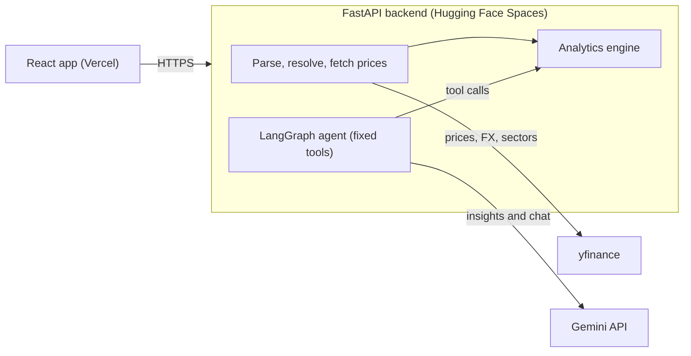

# Architecture and API

One repository, two deployables: a React app on Vercel calls a FastAPI service on Hugging Face Spaces. The analytics engine is plain Python; the LLM only helps with column mapping, insight wording and Q&A through fixed tools.



The browser talks only to the backend; the agent reads results from the analytics engine and never computes them.

## Tech stack

| Layer | Choice | Why |
| --- | --- | --- |
| Frontend | React, Vite, TypeScript, Plotly | Fast to build, strong chart support |
| Backend | Python 3.11+, FastAPI, pydantic v2, pandas, numpy | Typed API, standard for finance maths |
| Market data | yfinance (prices, sectors, USDINR=X) | Free, covers NSE, BSE and US |
| Agent | LangGraph with Gemini free tier | Graph of small, testable steps |
| Validation | quantstats, pytest | Independent reference for metrics |
| MLOps | Docker, GitHub Actions, optional Langfuse | CI/CD, tracing, repeatable deploys |
| Hosting | Hugging Face Spaces (Docker), Vercel | Both free tiers |

## API endpoints

| Method | Path | Request | Response |
| --- | --- | --- | --- |
| GET | /health | none | status, version, git sha |
| GET | /api/samples | none | list of sample portfolios |
| POST | /api/parse | file (CSV, Excel, JSON) | detected broker, holdings, warnings, unresolved symbols, or a request for column mapping |
| POST | /api/analyze | holdings, base currency, benchmark, lookback years | full analysis result |
| POST | /api/insights | analysis result | list of validated insights |
| POST | /api/chat | analysis result, message history | answer and the tool calls used |

## Data models

- **Holding:** symbol, name, quantity, average buy price, currency, exchange.
- **ResolvedHolding:** Holding plus Yahoo ticker, sector, latest price, market value in base currency.
- **AnalysisResult:** summary (value, invested, P&L, P&L %), weights, sector exposure, risk metrics, drawdown series, correlation matrix, warnings, disclaimer.

## Design decisions

- **Stateless:** the frontend holds holdings and results; the backend stores nothing.
- **LLM never computes:** every number comes from the analytics package, and insight text is checked against the analysis JSON before it is shown.
- **No code execution in chat:** the agent calls a fixed tool list (summary, top holdings, sectors, risk metrics, drawdown periods, correlations, risk contribution, what-if remove a stock).
- **Offline fallback:** a bundled price snapshot keeps the demo working if yfinance is rate-limited.

## Repository structure

```text
portfolio-risk-analyzer/
  CLAUDE.md
  README.md
  PROMPTS.md
  .env.example
  docs/
    PRD.md  ARCHITECTURE.md  METRICS.md  SETUP_AND_DEPLOYMENT.md  TEMPLATES.md
    VALIDATION.md  RESUME.md   (the last two are generated by Claude Code)
  backend/
    app/
      main.py  config.py  schemas.py
      routers/      health.py  parse.py  analyze.py  chat.py
      services/     parsers.py  tickers.py  prices.py  fx.py  sectors.py
      analytics/    returns.py  risk.py  drawdown.py  concentration.py  engine.py
      agent/        graph.py  tools.py  prompts.py  llm.py
    data/
      sample_portfolios/   (india, us, mixed)
      price_snapshot/      (offline prices for tests and demo)
      sector_map.csv
    tests/
      unit/  fixtures/  test_validation.py  evals/
    requirements.txt  requirements-dev.txt  Dockerfile
  frontend/               (Vite, React, TypeScript)
  scripts/
    snapshot_prices.py  validate_metrics.py  run_agent_eval.py
  .github/workflows/
    ci.yml  deploy-backend.yml  keepalive.yml
```
